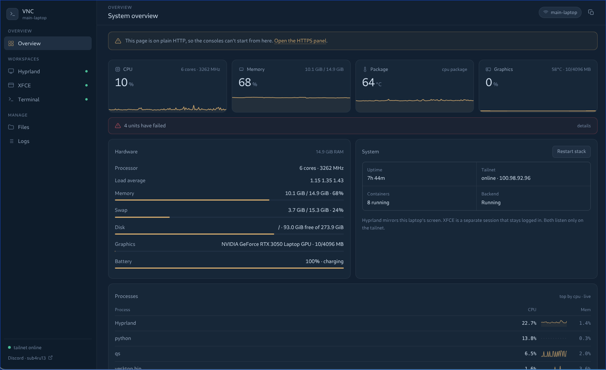
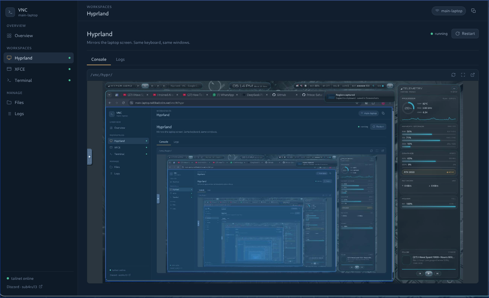
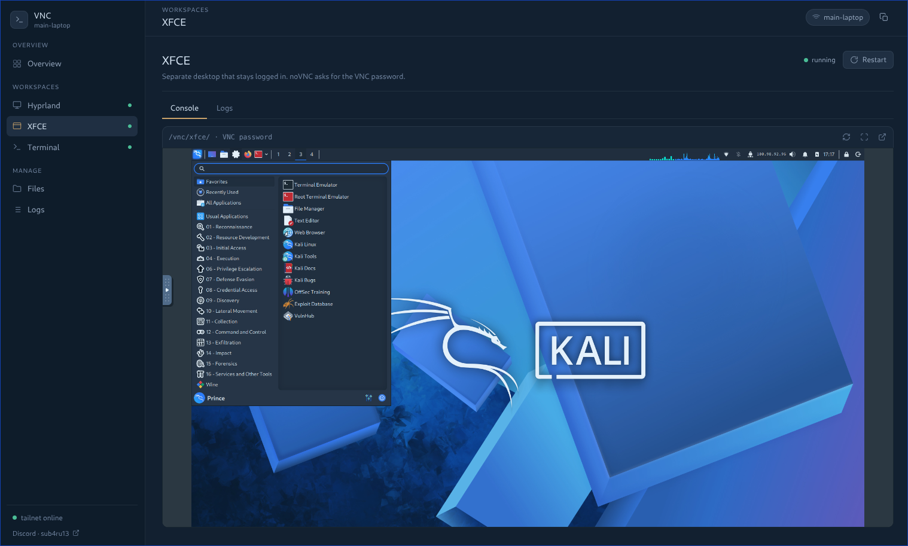
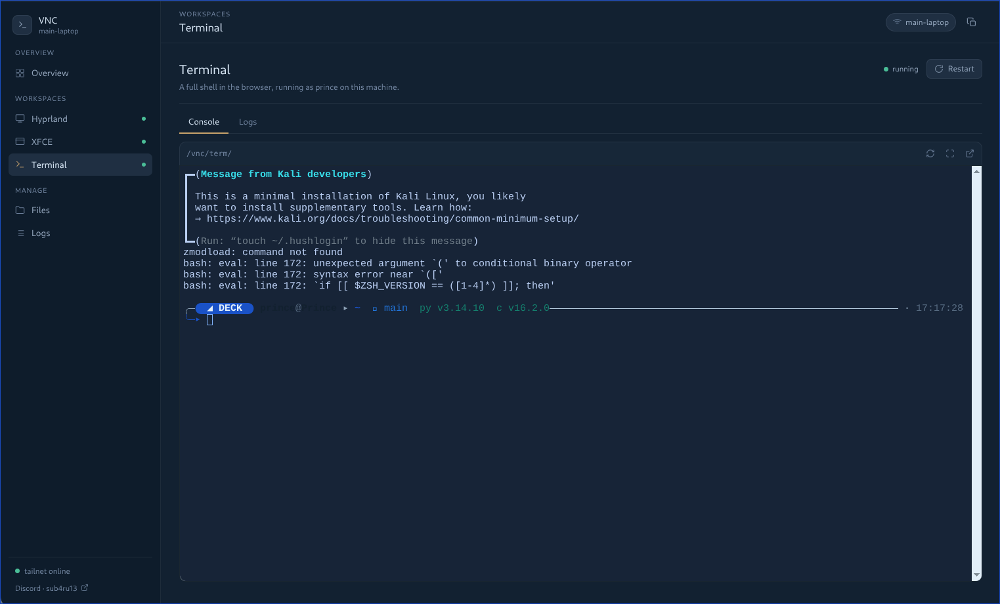

<p align="center">
  
</p>

<h1 align="center">TailDeck</h1>

<p align="center">
  A lightweight, self-hosted control deck for your own Linux machine — reachable only over <a href="https://tailscale.com">Tailscale</a>.
</p>

<p align="center">
  
  
  
  
  
</p>

---

TailDeck puts your **Hyprland** desktop, a persistent **XFCE** desktop, a full **terminal**, live hardware charts, file transfer and service logs behind one password-protected web page on your tailnet. Nothing is exposed to your LAN or the internet.

It is plain Python (standard library + `psutil`) and a dependency-free vanilla JS UI. There is no build step, no bundler, no framework, and no external requests — you clone it, run it, and open it in a browser.

<p align="center">
  
</p>

<p align="center"><sub><b>Overview</b> — live charts with 20 minutes of history, hardware details, Tailscale state, failed units and top processes.</sub></p>

## What you get

| | Feature |
|---|---|
| 🖥️ | **Hyprland console** — mirrors your real laptop/desktop screen through `wayvnc` + noVNC. Same keyboard, same windows. |
| 🪟 | **XFCE console** — a separate virtual desktop (TigerVNC) that stays logged in even when you disconnect. |
| ⌨️ | **Browser terminal** — a real shell over `ttyd`, no SSH client required. |
| 📊 | **Live metrics** — CPU, RAM, swap, disk, CPU package temperature, NVIDIA GPU (util, temp, VRAM), battery, load average, uptime and container count. Sparkline charts keep 20 minutes of history. |
| 🖼️ | **Screen previews** — live thumbnails of both desktops on the overview page (`grim` for Hyprland, `scrot`/`maim`/ImageMagick for XFCE). |
| 📂 | **Files** — drag-and-drop upload and download in a shared folder (defaults to `~/Downloads`), 512 MB per file. |
| 📜 | **Logs** — live `journalctl` streams for every unit in the stack, straight into the browser via SSE. |
| 🔁 | **Restart buttons** — bounce a single console, its proxy, or the whole stack from the page. |
| 🔒 | **Tailnet-only** — binds loopback by default, HTTP Basic Auth everywhere, same-origin checks on every mutating request and WebSocket upgrade. |
| 📱 | **Installable** — a web manifest and icons, so the panel can live on your phone's home screen. |

Missing optional tools never break the page: no `nvidia-smi` means the GPU card shows `—`, no `docker` means zero containers, no screenshot tool means "no preview".

## Screenshots

### Hyprland — mirrors your real screen



### XFCE — a separate desktop that stays logged in



When the VNC server has a password, noVNC asks for it once inside the console:


### Terminal — a full shell in the browser



### Files — move things between the machine and your browser


### Logs — watch any unit in the stack


## How it fits together

```
                    Tailscale (WireGuard, tailnet only)
                                   │
                     tailscale serve  →  HTTPS + /vnc mount
                                   │
                        ┌──────────▼──────────┐
                        │  TailDeck :6100     │   auth · CSRF · history · files
                        │  taildeck.py        │
                        └───┬──────┬──────┬───┘
              /hypr/*       │      │      │      /term/*
        ┌───────────────────┘      │      └────────────────────┐
        ▼                          ▼                           ▼
  websockify :6101          websockify :6102              ttyd :6103
        │                          │                           │
        ▼                          ▼                           ▼
  wayvnc :5900             TigerVNC :5902                 your shell
  (Hyprland screen)        (virtual XFCE desktop)
```

All console backends bind to `127.0.0.1` only. The panel proxies `/hypr/*`, `/xfce/*` and `/term/*` to them, injects the shared credentials and relays WebSockets, so the iframes never show a second Basic Auth prompt.

## Requirements

- Linux with **systemd user units** and **Tailscale**
- **Python 3.9+** (tested on 3.12) and `psutil` → `pip install -r requirements.txt`
- Optional, per feature:
  - `websockify` + `novnc` — both desktop consoles
  - `wayvnc` + `grim` — Hyprland console and thumbnail
  - `tigervnc-standalone-server` — virtual XFCE desktop
  - `ttyd` — browser terminal
  - `scrot`, `maim` or ImageMagick — XFCE thumbnail
  - `nvidia-smi` — GPU metrics · `docker` — container count

## Quick start

```sh
git clone https://github.com/Prince-Sahani137/taildeck.git ~/taildeck
cd ~/taildeck

python3 -m venv .venv
.venv/bin/pip install -r requirements.txt

cp .env.example .env
chmod 600 .env
$EDITOR .env        # set PANEL_USER and a long random PANEL_PASSWORD

scripts/run-taildeck.sh    # panel on http://127.0.0.1:6100
```

Generate a password with:

```sh
openssl rand -hex 16
```

> The panel refuses to start without a real `PANEL_PASSWORD`; the `CHANGE_ME` placeholder is rejected.

### Expose it on your tailnet (HTTPS)

noVNC and the terminal need a secure context, so serve the panel over HTTPS rather than hitting `:6100` directly:

```sh
tailscale serve --bg --set-path /vnc http://127.0.0.1:6100
tailscale serve status          # shows the exact URL
```

Open the printed URL:

```
https://<your-machine>.<your-tailnet>.ts.net/vnc/
```

The panel is mounted under `/vnc`; `tailscale serve` strips that prefix before proxying, and TailDeck accepts both the stripped and prefixed forms.

## Enabling the consoles

Each console is optional and independent. Start the pieces you want:

### Terminal

```sh
scripts/run-term.sh     # ttyd on 127.0.0.1:6103
```

### Hyprland (mirror your current session)

Start `wayvnc` **inside your running Hyprland session**:

```sh
wayvnc 127.0.0.1 5900
scripts/run-ws-hypr.sh  # websockify on 127.0.0.1:6101
```

### XFCE (separate persistent desktop)

One-time setup — create a VNC password (noVNC will ask for it):

```sh
vncpasswd
```

Then start the virtual desktop and its proxy:

```sh
systemctl --user enable --now taildeck-xfce   # TigerVNC :2 (port 5902)
scripts/run-ws-xfce.sh                        # websockify on 127.0.0.1:6102
```

`scripts/xfce-no-blank.sh` disables screen blanking and the lock screen so the remote desktop stays usable.

## Run as services

Copy the user units (they expect the project at `~/taildeck`):

```sh
mkdir -p ~/.config/systemd/user
cp systemd/*.service ~/.config/systemd/user/
systemctl --user daemon-reload

systemctl --user enable --now taildeck taildeck-term           # core + terminal
systemctl --user enable --now wayvnc taildeck-ws-hypr          # Hyprland (optional)
systemctl --user enable --now taildeck-xfce taildeck-ws-xfce   # XFCE (optional)

loginctl enable-linger "$USER"    # keep them running after logout
```

The unit names matter: the Restart buttons and the Logs tab call them by name. Review `systemd/taildeck-xfce.service` and `systemd/wayvnc.service` first — they are examples that depend on your distro, display server and session.

## Configuration

Everything lives in `.env` (copy `.env.example`). Real environment variables win over the file. `.env` is git-ignored.

| Variable | Default | Purpose |
|---|---|---|
| `PANEL_USER` | `admin` | Login user for the panel and console backends |
| `PANEL_PASSWORD` | — | **Required.** Shared password; `CHANGE_ME` is refused |
| `PANEL_BIND` | `127.0.0.1` | Bind address; `tailscale` means this node's tailnet IPv4 |
| `PANEL_PORT` | `6100` | Panel HTTP port |
| `PROJECT_NAME` | `TailDeck` | Name shown in the UI |
| `WS_HYPR_HOST` / `WS_HYPR_PORT` | `127.0.0.1` / `6101` | Hyprland websockify backend |
| `WS_XFCE_HOST` / `WS_XFCE_PORT` | `127.0.0.1` / `6102` | XFCE websockify backend |
| `TERM_HOST` / `TERM_PORT` | `127.0.0.1` / `6103` | ttyd backend |
| `VNC_HYPR_PORT` / `VNC_XFCE_PORT` | `5900` / `5902` | Real VNC servers the proxies connect to |
| `NOVNC_DIR` | `/usr/share/novnc` | noVNC web files |
| `TERM_SHELL` | `$SHELL` | Shell the browser terminal starts |
| `XFCE_DISPLAY` | `:2` | X display for thumbnails and the no-blank script |
| `FILES_DIR` | `~/Downloads` | Shared folder behind the Files tab |
| `MAX_UPLOAD` | `536870912` (512 MB) | Max upload size in bytes |
| `HTTPS_ORIGIN` | auto | Override the HTTPS mount URL (otherwise from `tailscale status`) |
| `STATS_TTL` / `THUMB_TTL` | `2` / `5` | Cache seconds for stats and thumbnails |
| `HISTORY_INTERVAL` / `HISTORY_SIZE` | `3` / `400` | Chart sample interval and ring-buffer size |

## API

All endpoints require HTTP Basic Auth.

| Endpoint | Purpose |
|---|---|
| `GET /` | Dashboard UI |
| `GET /api/stats` | Live CPU/RAM/disk/GPU/temps/processes/Tailscale |
| `GET /api/history` | Last 20 minutes of chart samples |
| `GET /api/units` | systemd state for every unit behind the cards |
| `GET /api/config` | Non-secret settings for the page |
| `GET /api/thumb?which=hypr\|xfce` | Live PNG desktop preview |
| `GET /api/logs?unit=<key>` | Live journal stream (SSE) |
| `POST /api/action` | `{"target":"hypr\|xfce\|term\|vnc-stack"}` restart |
| `GET /api/files` | List the shared folder |
| `POST /api/files?name=<file>` | Upload one file (raw body, needs `X-Panel: 1`) |
| `GET /api/files/get?name=<file>` | Download one file |
| `* /hypr/*`, `/xfce/*`, `/term/*` | Proxied consoles (HTTP + WebSocket) |

## Project structure

```
taildeck/
├── taildeck.py            # HTTP server: routing, auth, CSRF/origin guards,
│                          # console proxying, history sampler, files, SSE logs
├── metrics.py             # CPU/RAM/disk/GPU/temps/processes/Tailscale (psutil + CLI)
├── xcap.py                # XFCE screenshot capture for the overview thumbnail
├── index.html             # single-page UI shell (all views + inline SVG icons)
├── style.css              # dark theme, layout, charts and console styling
├── app.js                 # vanilla JS: routing, polling, charts, consoles, files, logs
├── icon.svg               # favicon
├── manifest.webmanifest   # installable web app metadata
├── requirements.txt       # psutil
├── .env.example           # documented configuration template
│
├── scripts/
│   ├── _env.sh            # sources ../.env, validates PANEL_PASSWORD
│   ├── run-taildeck.sh    # panel (uses ./.venv/bin/python when present)
│   ├── run-term.sh        # ttyd on 127.0.0.1:6103
│   ├── run-ws-hypr.sh     # websockify :6101 -> wayvnc :5900
│   ├── run-ws-xfce.sh     # websockify :6102 -> TigerVNC :5902
│   └── xfce-no-blank.sh   # disable XFCE blanking / lock screen
│
├── systemd/               # user units (expect the project in ~/taildeck)
│   ├── taildeck.service       # the panel
│   ├── taildeck-term.service  # ttyd
│   ├── taildeck-ws-hypr.service
│   ├── taildeck-ws-xfce.service
│   ├── taildeck-xfce.service  # TigerVNC virtual desktop (example)
│   └── wayvnc.service         # Hyprland VNC server (example)
│
├── tests/
│   └── smoke_test.py      # end-to-end test with fake console backends
│
├── img/                   # README screenshots, logo and social preview
│   ├── logo.svg · logo.png · social-preview.png
│   ├── dashboard.png · hypr.png · xfce.png · xfce2.png
│   └── terminal.png · files.png · logs.png
│
├── CONTRIBUTING.md
├── SECURITY.md
├── LICENSE                # MIT
└── README.md
```

Runtime state — `.env`, `.tailnet-name`, `.venv/`, `__pycache__/` and partial uploads — is git-ignored.

## Security model

TailDeck hands out shell and desktop access, so treat it accordingly.

- **Tailnet only.** Listens on loopback by default; set `PANEL_BIND=tailscale` to bind the tailnet IP. Reach it through `tailscale serve` or the tailnet, never by opening a port to the internet or LAN.
- **HTTP Basic Auth** on every request; failed logins are delayed by 1 second.
- **CSRF protection.** Mutating requests need `X-Panel: 1`, and any request carrying an `Origin` header — including WebSocket upgrades — must be same-origin, so a malicious page cannot ride on cached credentials against your terminal.
- **Loopback backends.** websockify and ttyd bind `127.0.0.1` and require the same credentials. Their password appears on the process command line, so other local users can see it in `ps` — this is designed for a single-user machine.
- **Path safety.** Uploads and downloads are restricted to plain filenames inside `FILES_DIR`; hidden names and traversal attempts are rejected.

Use a long random `PANEL_PASSWORD`, keep `.env` at `chmod 600`, and keep your Tailscale ACLs tight. To report a vulnerability, see [SECURITY.md](SECURITY.md) — please do not open a public issue.

## Troubleshooting

| Symptom | Fix |
|---|---|
| `set a real PANEL_PASSWORD` on start | Copy `.env.example` to `.env` and set a password |
| Consoles say they need HTTPS | Open the `https://…ts.net/vnc/` URL from `tailscale serve`, not `http://IP:6100` |
| Console tab shows 502 | That backend isn't running: `systemctl --user status taildeck-ws-hypr` (or `-xfce`, `-term`) |
| Hyprland console is black | Start `wayvnc 127.0.0.1 5900` inside the Hyprland session |
| Hyprland thumbnail missing | Needs `grim` and a running Hyprland session |
| XFCE thumbnail missing | Install `scrot`, `maim` or ImageMagick and check `XFCE_DISPLAY` |
| XFCE console asks for a password | It's the VNC password from `vncpasswd` |
| Restart buttons do nothing | Unit names must match the files in `systemd/` |
| Upload fails with 413 | File exceeds `MAX_UPLOAD` |

## Tests

```sh
python3 -m venv .venv && .venv/bin/pip install -r requirements.txt
.venv/bin/python tests/smoke_test.py     # prints ALL PASSED
node --check app.js                      # JS syntax check
```

The smoke test starts the panel with fake console backends and checks auth, CSRF/origin rules, the API, file upload/download safety, HTTP proxying and WebSocket echo/refusal. It needs no Tailscale, Hyprland or VNC server.

## Contributing

Issues and pull requests are welcome — see [CONTRIBUTING.md](CONTRIBUTING.md). The short version: stay dependency-light, never commit secrets or machine-specific values, and add a test for anything security-sensitive.

## License

This project is licensed under the MIT License. See the [LICENSE](LICENSE) file for details.
